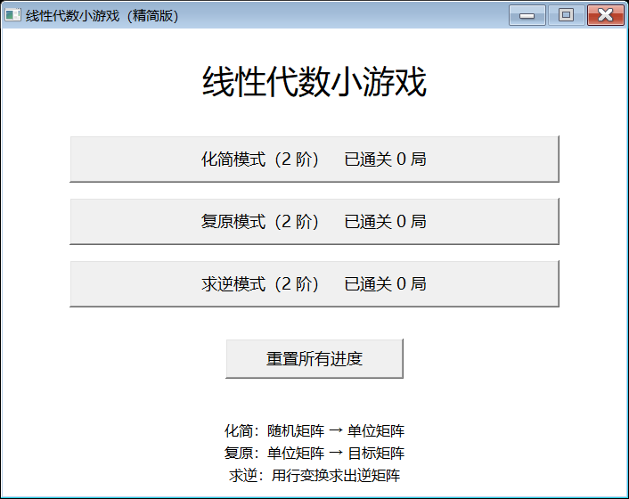
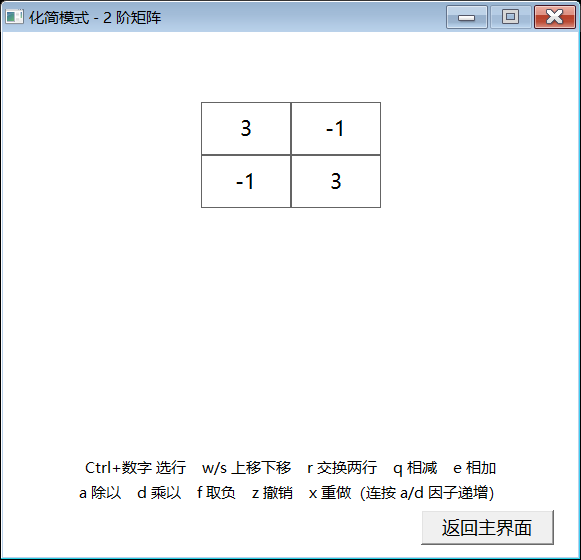
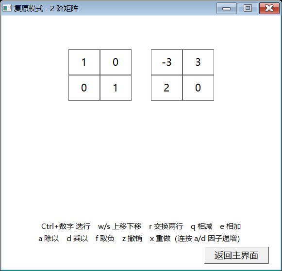
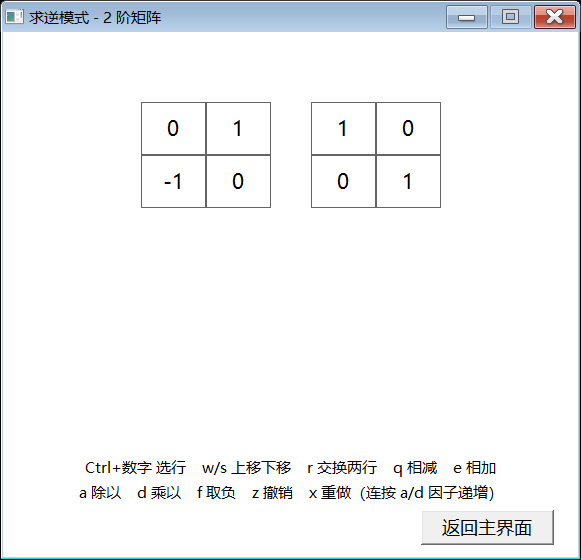

# 线性代数小游戏（精简版）代码结构说明

> **C++ 课程设计** ｜ 共 5 个模块、**998 行**（程序本体 908 行 + 测试 90 行）
> 功能：化简、复原、求逆三种模式的矩阵初等行变换练习
> 验证：`build.bat test` → 通过 49 项，失败 0 项

---

## 0. 这份文档怎么用

全文按"**上台讲 10 分钟**"来组织。每个模块都写成三段：

| 段落 | 作用 |
|---|---|
| **模块定位** | 一句话说清它为什么存在 |
| **逐段讲解** | 配着源码从上往下看，每段都写了"这段在干什么、为什么这么写" |
| **讲解要点** | 可以直接照着念的话术 |

行首标记：

- **⭐** = 必须讲，10 分钟里不能省
- **○** = 时间富余再讲，赶时间就跳过
- **△** = 一句话带过（Win32 相关，按现在的学习进度不要求掌握）

### 10 分钟时间表（建议）

| 时间 | 内容 | 对应章节 |
|---|---|---|
| 0:00–0:45 | 项目是什么、为什么写它 | §1.1 |
| 0:45–2:00 | 整体架构：5 个模块 + 一次按键的旅程 | §1.2–§1.3 |
| 2:00–3:30 | **fraction**：为什么不能直接用 double | §2 |
| 3:30–5:00 | **matrix**：三种行变换就是全部武器 | §3 |
| 5:00–8:00 | **game**：三模式统一成一个状态机 + `press()` + a/d 连击 | §4 |
| 8:00–8:45 | **ui / main**：只讲"它们负责画"和"它们不碰规则" | §5–§6 |
| 8:45–9:30 | 跑一遍演示（三种模式各走一步） | §8 |
| 9:30–10:00 | 收获与不足 | §9 |

### 目录

- [1. 整体架构](#1-整体架构)
- [2. 模块一：fraction —— 精确有理数](#2-模块一fraction--精确有理数)
- [3. 模块二：matrix —— 矩阵与三种行变换](#3-模块二matrix--矩阵与三种行变换)
- [4. 模块三：game —— 游戏规则（核心）](#4-模块三game--游戏规则核心)
- [5. 模块四：ui —— Win32 界面封装（一笔带过）](#5-模块四ui--win32-界面封装一笔带过)
- [6. 模块五：main —— 程序组装（一笔带过）](#6-模块五main--程序组装一笔带过)
- [7. 三种模式对照表](#7-三种模式对照表)
- [8. 界面截图与演示脚本](#8-界面截图与演示脚本)
- [9. 与原 Python 版的差异](#9-与原-python-版的差异)
- [10. 构建与运行](#10-构建与运行)
- [11. 五人分工建议](#11-五人分工建议)
- [12. 可能被问到的问题](#12-可能被问到的问题)
- [附录 A：文件清单](#附录-a文件清单)
- [附录 B：测试说明](#附录-b测试说明)

---

## 1. 整体架构

### 1.1 项目是什么 ⭐

一个帮助练习**矩阵初等行变换**的小程序。程序随机给出一个矩阵，玩家用键盘做行变换，把它化成目标形式。三种玩法：

| 模式 | 开局 | 目标 | 练的是什么 |
|---|---|---|---|
| **化简** | 随机可逆矩阵 | 化成单位矩阵 | 高斯消元的基本功 |
| **复原** | 单位矩阵 + 一个目标矩阵 | 把单位矩阵变成目标矩阵 | 反向思考：目标怎么来 |
| **求逆** | 随机可逆矩阵 + 单位矩阵 | 左边化单位阵，右边即是逆矩阵 | 用行变换求逆的标准方法 |

原版是 Python + tkinter 写的。我们把它**用 C++ 重写**，保留三种玩法的全部规则，同时把 11669 行的规模压到 **998 行**——因为课程设计要能讲清楚，而不是代码越多越好。

### 1.2 五个模块与依赖方向 ⭐

```
                     main.cpp  (235 行)
                   程序组装 + 界面绘制
                    ╱              ╲
              game.h/.cpp        ui.h/.cpp
              (211 行)            (264 行)
              游戏规则              画控件
                 │
            matrix.h/.cpp
              (102 行)
            矩阵 + 三种行变换
                 │
           fraction.h/.cpp
               (96 行)
              精确分数
```

**依赖只能从上往下**，下层永远不知道上层的存在：

- `fraction` 不认识矩阵，更不认识游戏
- `matrix` 会用分数，但不知道"模式""胜利"
- `game` 会算矩阵，但**一行界面代码都没有**（`#include "ui.h"` 在 game 里是找不到的）
- `ui` 只管画，不知道矩阵是什么
- `main` 负责把上面四层粘起来

> **讲解要点**：这条单向依赖线是整个设计最关键的地方。它带来的直接好处是——**游戏规则可以在命令行里测试**，不需要打开窗口（这正是附录 B 那 49 项测试能跑起来的原因）。

### 1.3 一次按键的旅程 ⭐⭐

这是全场最值得讲的一页，它把五个模块串成了一条线：

```
玩家按下 'q'（当前行减去上一行）
   │
   │ ① ui.cpp:185  runLoop()
   │    消息循环抓到 WM_KEYDOWN，把虚拟键码换成字符 'q'
   ▼
   │ ② main.cpp:92  App::run() 里注册的那个 lambda
   │    if (game_->press(char(key))) { refresh(); if (game_->won()) onWin(); }
   ▼
   │ ③ game.cpp:100  Game::press('q')
   │    判断有没有选行 → save() 存档 → addBoth(row_, lastRow_, -1)
   ▼
   │ ④ game.cpp:47  Game::addBoth()
   │    addRow(main_, ...);  求逆模式下再加一句 addRow(extra_, ...)
   ▼
   │ ⑤ matrix.cpp:77  addRow()
   │    第 dst 行的每一格 += k × 第 src 行的对应格
   ▼
   │ ⑥ fraction.cpp:31  Fraction::operator+=
   │    分数通分相加，立刻约分，全程整数运算
   ▼
   │ ⑦ 返回 true → main.cpp:199  App::refresh()
   │    把新数字写回格子、按行号重新上色
   ▼
   屏幕更新完毕
```

> **讲解要点**：注意 ③ 返回的那个 `bool`。`press()` 返回"矩阵到底变了没有"，界面拿它决定要不要重画。按了没用的键（比如已经在最上面还按 `w`）就返回 `false`，界面完全不动——这样既省性能，也不会让玩家看到无意义的闪烁。

---

## 2. 模块一：fraction —— 精确有理数

**文件**：`fraction.h`（39 行）、`fraction.cpp`（57 行），合计 **96 行**

### 2.1 为什么不能用 double ⭐⭐

这是整个项目**最重要的一次技术选择**，也是开头最好的引子。

做行变换时会不断产生分数。比如把第 2 行除以 3：

```
1/3 = 0.3333333333333333      （double 只能存近似值）
再乘以 3  →  0.9999999999999999   ← 不等于 1！
```

于是**永远凑不出单位矩阵**，明明做对了却不判胜利。

> 这不是"精度差一点"的问题，而是**逻辑上不可能通过**。
> 所以必须自己写一个分数类型，分子分母都用整数，全程精确。

### 2.2 类定义 ⭐

`fraction.h:9`

```cpp
class Fraction {
public:
    Fraction() : num_(0), den_(1) {}                     // 默认值是 0
    Fraction(long long n) : num_(n), den_(1) {}          // 整数可以隐式转换成分数
    Fraction(long long num, long long den);              // 自动约分，负号一律放到分子上
```

三个构造函数分别对应三种用法：

```cpp
Fraction a;              // 0
Fraction b = 3;          // 3        ← 因为有这个构造，矩阵里可以直接写 Fraction(1)
Fraction c(1, 2);        // 1/2
```

**不变量（invariant）**——整个类任何时候都保证这两条：

1. `den_ > 0`（分母永远是正的，负号统一放在分子上）
2. `gcd(|num_|, den_) == 1`（一定是最简分数）

> **讲解要点**：保证不变量有什么好处？看后面 `operator==` 就懂了。

### 2.3 约分 ⭐

`fraction.cpp:18`

```cpp
void Fraction::reduce() {
    if (den_ < 0) {                                      // ① 负号一律挪到分子上
        num_ = -num_;
        den_ = -den_;
    }
    const long long g = gcd(absolute(num_), den_);       // ② 分子分母的最大公约数
    if (g > 1) {                                         // ③ 一起除掉，得到最简形式
        num_ /= g;
        den_ /= g;
    }
}
```

三步很直白：先统一符号，再求 `gcd`，再一起除。

`absolute()` 是自己写的（`fraction.cpp:6`）：

```cpp
static long long absolute(long long v) { return v < 0 ? -v : v; }
```

`gcd()` 用的是标准库 `<numeric>` 里的，不用自己实现。

### 2.4 四则运算 ⭐

`fraction.cpp:31` 起。这里用了 C++ 里一个很实用的套路：**赋值版 + 转调用**。

```cpp
Fraction& Fraction::operator+=(const Fraction& o) {
    num_ = num_ * o.den_ + o.num_ * den_;     // 通分：a/b + c/d = (ad + cb) / bd
    den_ *= o.den_;
    reduce();                                 // 每次算完立刻约分
    return *this;
}

Fraction& Fraction::operator-=(const Fraction& o) { return *this += (-o); }   // 减法 = 加相反数
```

头文件里再让 `+` 去调用 `+=`（`fraction.h:25-28`）：

```cpp
friend Fraction operator+(Fraction a, const Fraction& b) { return a += b; }
```

**为什么要绕这一下**：

- `+=` 里的逻辑只写**一份**，`+` 直接复用，不会出现"加法和加等于算得不一样"的 bug
- `operator+` 的第一个参数是**按值传**的（`Fraction a`），拿到的是一份拷贝，随便改都不影响外面
- 这就是 C++ 教材里常说的"用赋值运算符实现算术运算符"

`operator-=` 写成一行 `return *this += (-o);`，把减法化成加法——**少写一份通分逻辑**。

乘除法同理（`fraction.cpp:40`、`47`），只是 `/= ` 要乘以倒数：

```cpp
Fraction& Fraction::operator/=(const Fraction& o) {
    num_ *= o.den_;
    den_ *= o.num_;
    reduce();
    return *this;
}
```

### 2.5 相等判断 ⭐

`fraction.h:30`

```cpp
friend bool operator==(const Fraction& a, const Fraction& b) {
    return a.num_ == b.num_ && a.den_ == b.den_;
}
```

只比较两个整数就行了——**正因为 2.2 那两条不变量保证了"每个数只有唯一的一种写法"**：

```
1/2 只能存成 (1, 2)，绝不可能存成 (2, 4) 或 (-1, -2)
```

如果不约分，`1/2` 和 `2/4` 就会判不相等，胜利条件直接失效。

> **讲解要点**：这一句是"不变量"这个概念的完美例子：**维护时多花一点力气，使用时就能省掉一大堆判断**。

### 2.6 显示

`fraction.cpp:54` 附近的 `str()`：

```cpp
string Fraction::str() const {
    if (den_ == 1) return to_string(num_);              // 整数就直接显示
    return to_string(num_) + "/" + to_string(den_);     // 否则显示 "分子/分母"
}
```

因为分母恒正，负分数的显示自然就是 `-1/2`，不会出现 `1/-2`。

---

## 3. 模块二：matrix —— 矩阵与三种行变换

**文件**：`matrix.h`（23 行）、`matrix.cpp`（79 行），合计 **102 行**

### 3.1 矩阵就是一个二维数组 ⭐

`matrix.h:11`

```cpp
typedef vector<vector<Fraction>> Matrix;                 // 类型别名，写起来短
```

一层 `vector` 是行，里面再套一层是列。于是：

```cpp
m[i][j]     // 第 i 行第 j 列
m[i]        // 整个第 i 行
m.size()    // 行数
```

用 `typedef` 起个短名字，后面所有函数签名都清爽很多。

### 3.2 三种初等行变换 ⭐⭐

**整个游戏的全部武器就这三个函数**（`matrix.cpp:71-77`）：

```cpp
void scaleRow(Matrix& m, int row, const Fraction& k) {          // 第 row 行整体乘以 k
    for (int j = 0; j < int(m[row].size()); ++j) m[row][j] *= k;
}

void swapRows(Matrix& m, int i, int j) { swap(m[i], m[j]); }    // 交换第 i、j 两行

void addRow(Matrix& m, int dst, int src, const Fraction& k) {   // 第 dst 行 += k × 第 src 行
    for (int j = 0; j < int(m[dst].size()); ++j) m[dst][j] += k * m[src][j];
}
```

线性代数课本里的三种初等行变换，就是这三行代码。

> **讲解要点**：这一点很值得强调——**看起来复杂的"矩阵求逆"，拆开就是这三个操作的排列组合**。玩家做的每一步，程序做的每一步，都只是这三者之一。

注意它们都收 `Matrix&`（**引用**）：直接改原矩阵，不产生拷贝，也不返回值。

### 3.3 单位矩阵与判定

`matrix.cpp:8`

```cpp
Matrix identity(int n) {
    Matrix m(n, vector<Fraction>(n));
    for (int i = 0; i < n; ++i) m[i][i] = Fraction(1);
    return m;
}
```

`vector<Fraction>(n)` 造一行 n 个 0（因为 `Fraction()` 默认就是 0），`Matrix(n, ...)` 再造 n 行。

`matrix.cpp:14` 的判定：

```cpp
bool isIdentity(const Matrix& m) {
    const int n = int(m.size());
    for (int i = 0; i < n; ++i)
        for (int j = 0; j < n; ++j)
            if (m[i][j] != Fraction(i == j ? 1 : 0)) return false;
    return true;
}
```

`i == j ? 1 : 0` 就是"主对角线为 1、其它为 0"的数学写法。**这是化简模式和求逆模式的胜利条件**。

### 3.4 求秩：为什么可逆要先算秩 ⭐

要随机生成一个"可逆矩阵"，就得先能判断可逆。

线性代数结论：**n 阶方阵可逆 ⇔ 秩 = n**。所以先写求秩（`matrix.cpp:32`）：

```cpp
int matrixRank(Matrix m) {                  // 参数按值传入 = 自动拷贝一份，内部随便改
    const int rows = int(m.size());
    const int cols = rows > 0 ? int(m[0].size()) : 0;
    int r = 0;                                       // r = 已经找到的主元个数
    for (int c = 0; c < cols && r < rows; ++c) {
        int pivot = -1;                              // 在第 c 列找第一个非零元素
        for (int i = r; i < rows; ++i) {
            if (!m[i][c].isZero()) { pivot = i; break; }
        }
        if (pivot < 0) continue;                     // 这一列全是 0，没有主元，跳过
        swap(m[r], m[pivot]);                        // 把主元所在行换到第 r 行
        scaleRow(m, r, Fraction(1) / m[r][c]);       // 把主元变成 1
        for (int i = 0; i < rows; ++i) {             // 把这一列的其它行都消成 0
            if (i != r && !m[i][c].isZero()) addRow(m, i, r, -m[i][c]);
        }
        ++r;
    }
    return r;
}
```

就是标准的高斯消元：**一列一列扫，每列找一个非零主元，用它把该列其它位置消成 0，最后数一数找到了几个主元**。

两个细节值得讲：

1. **参数是 `Matrix m` 不是 `Matrix& m`** —— 按值传，函数内部改的是副本，调用者的矩阵不受影响。这比在函数里手动拷贝更省事。
2. **用的是 `scaleRow` / `addRow` 而不是手写循环** —— 求秩本身就是行变换，直接复用 3.2 那三个函数。

有了秩，可逆就一行（`matrix.cpp:52`）：

```cpp
bool invertible(const Matrix& m) {
    const int n = int(m.size());
    for (int i = 0; i < n; ++i)
        if (int(m[i].size()) != n) return false;     // 不是方阵，一律不可逆
    return matrixRank(m) == n;                        // 方阵：满秩才可逆
}
```

### 3.5 随机可逆矩阵 ⭐

`matrix.cpp:60`

```cpp
Matrix randomInvertible(int n) {
    for (;;) {                                        // 无限循环，直到成功
        Matrix m(n, vector<Fraction>(n));
        for (int i = 0; i < n; ++i)
            for (int j = 0; j < n; ++j)
                m[i][j] = Fraction(rand() % 7 - 3);   // %7 得到 0..6，减 3 就是 -3..3
        if (invertible(m)) return m;                  // 不可逆就重来
    }
}
```

这是一个**拒绝采样（rejection sampling）**：

- 元素取 `-3..3`，和原 Python 版一致
- 生成后立刻检查，不行就重来
- 低阶矩阵几乎总是可逆，所以平均只试一两次；即使偶尔连试几次，代价也很小

> **讲解要点**：`for (;;)` 看着像要死循环，其实出口在 `return` 里。这类"试探-检查-重试"的写法在随机算法里非常常见。

---

## 4. 模块三：game —— 游戏规则（核心）

**文件**：`game.h`（54 行）、`game.cpp`（157 行），合计 **211 行**

> 这是全场**最该花时间**的模块。它完全不碰界面，所以可以纯逻辑地讲。

### 4.1 三种模式其实是一个状态机 ⭐⭐⭐

这是本项目的**设计核心**，也是最漂亮的一处抽象。

乍看三种玩法差别很大，但拆开看，它们的区别只有两个：

| 模式 | `main_` 初始 | `extra_` 初始 | 胜利条件 |
|---|---|---|---|
| 化简 | 随机可逆矩阵 | 单位矩阵 | `isIdentity(main_)` |
| 复原 | 单位矩阵 | 随机矩阵（目标） | `equal(main_, extra_)` |
| 求逆 | 随机可逆矩阵 | 单位矩阵 | `isIdentity(main_)` |

**共同点**：

- 玩家操作的都是 `main_`（左边那块）
- 行变换永远只作用在 `main_` 上
- 区别只是"从什么出发"和"怎样算赢"

**唯一的不对称**是求逆模式：右边那块也要跟着变，因为右侧要同时被化成逆矩阵。

于是只需要一个类（`game.h:17`），用 `mode_` 区分三种玩法。

`game.cpp:16` 的构造函数把这个表直接写成了代码：

```cpp
Game::Game(Mode mode, int n) : mode_(mode), n_(n) {
    if (mode_ == Mode::Restore) {
        main_ = identity(n);                         // 复原：从单位矩阵出发，去凑目标矩阵
        extra_ = busyMatrix(n);
    } else {
        main_ = busyMatrix(n);                       // 化简 / 求逆：从随机矩阵出发，化成单位阵
        extra_ = identity(n);
    }
}
```

化简和求逆的初始化**完全一样**，所以合并在一个 `else` 里——这就是"统一状态机"省下来的东西。

> **讲解要点**：如果按三种模式写三个类，那些"选行 / 撤销 / 按键分发 / 行变换"要各写三遍，一共 600+ 行且处处要同步维护。合成一个类之后是 211 行，而且**加第四种模式只需要改这几行**。

### 4.2 `busyMatrix`：开局不能已经赢了

`game.cpp:8`

```cpp
Matrix busyMatrix(int n) {
    Matrix m;
    do { m = randomInvertible(n); } while (isIdentity(m));
    return m;
}
```

如果随机出来的恰好是单位矩阵，化简模式**一开局就已经赢了**。所以要一直重抽到"不是单位矩阵"为止。

### 4.3 三个"带同步"的行变换 ⭐⭐

这是求逆模式能成立的关键（`game.cpp:31-44`）：

```cpp
void Game::scaleBoth(int row, const Fraction& k) {
    scaleRow(main_, row, k);
    if (mode_ == Mode::Inverse) scaleRow(extra_, row, k);
}

void Game::swapBoth(int i, int j) {
    swapRows(main_, i, j);
    if (mode_ == Mode::Inverse) swapRows(extra_, i, j);
}

void Game::addBoth(int dst, int src, const Fraction& k) {
    addRow(main_, dst, src, k);
    if (mode_ == Mode::Inverse) addRow(extra_, dst, src, k);
}
```

**为什么求逆要同步**：课本上的方法是对 `[A | I]` 这个增广矩阵做行变换。左边 A 化成 I 的同时，右边的 I 就被化成了 A⁻¹。

所以代码里"对左边做的每一个动作，对右边做同样一遍"。那个 `if (mode_ == Mode::Inverse)` 就是"要不要同步"的开关。

> **讲解要点**：注意这三个函数是**唯一**改动矩阵的入口。`press()` 里所有按键最终都落到这里，**没有任何地方绕过它们直接改 `main_`**。这保证了求逆模式下左右永远不会不同步。

### 4.4 撤销 / 重做：快照法 ⭐⭐

最朴素也最可靠的做法：**每次操作前，把整个状态存一份**。

先定义"快照"（`game.h:35`）：

```cpp
struct Snapshot { Matrix main, extra; int row, lastRow; };
```

只有四个字段：两块矩阵 + 两个行号。比"记录操作类型再反向执行"简单得多，也不会因为操作种类变多而漏掉某种逆运算。

抓快照（`game.cpp:49`）：

```cpp
Game::Snapshot Game::grab() const {
    Snapshot s;
    s.main = main_;
    s.extra = extra_;
    s.row = row_;
    s.lastRow = lastRow_;
    return s;
}
```

存档 / 恢复（`game.cpp:58`、`63`）：

```cpp
void Game::save() {
    history_.push_back(grab());
    if (int(history_.size()) > kMaxHistory) history_.erase(history_.begin());   // 太老的丢掉
}

void Game::restore(const Snapshot& s) {
    main_ = s.main;
    extra_ = s.extra;
    row_ = s.row;
    lastRow_ = s.lastRow;
    forgetRepeat();
}
```

`kMaxHistory = 100`——最多记 100 步，和原版一致，防止玩久了内存一直涨。

撤销和重做**互为镜像**（`game.cpp:71`、`79`）：

```cpp
bool Game::undo() {
    if (history_.empty()) return false;              // 没得撤
    redo_.push_back(grab());                         // 先把当前状态存进重做栈
    restore(history_.back());                        // 再恢复上一步
    history_.pop_back();
    return true;
}

bool Game::redo() {
    if (redo_.empty()) return false;
    history_.push_back(grab());
    restore(redo_.back());
    redo_.pop_back();
    return true;
}
```

> **讲解要点**：这两个函数结构完全一样，只是两个栈的角色互换——`undo` 从 `history_` 取、往 `redo_` 存；`redo` 反过来。**"先把现状推到对面的栈里，再恢复目标"**，这是所有撤销/重做的通用套路，Word、PS 里都是这个模型。

### 4.5 选行 ⭐

`game.cpp:87`

```cpp
void Game::selectRow(int r) {
    if (r < 0 || r >= n_ || r == row_) return;       // 越界、或者点的就是当前行，什么都不做
    lastRow_ = row_;                                 // 原来的当前行降级成"上一次行"
    row_ = r;
    forgetRepeat();
}
```

只有两个行号状态：

- `row_` = **当前行**（`q`/`e`/`a`/`d`/`f` 作用在它上面）
- `lastRow_` = **上一次选的行**（`q`/`e`/`r` 拿它当另一操作数）

选新行时，旧的当前行降级成"上一次行"。`r == row_` 时直接返回——**重复点同一行不改变状态**，否则 `lastRow_` 会被冲掉，`q`/`e`/`r` 就没法用了。

界面上的配色也对应这两个字段：

| 行 | 颜色 | 含义 |
|---|---|---|
| `row_` | 绿色 | 当前操作行 |
| `lastRow_` | 黄色 | 上一次的行（`q`/`e`/`r` 的另一方） |
| 其它 | 白色 | — |

### 4.6 `press()` —— 按键总入口 ⭐⭐⭐

`game.cpp:100`，是整个游戏最短也最密集的一段。

```cpp
bool Game::press(char key) {
    if (key == 'z') return undo();                   // 撤销
    if (key == 'x') return redo();                   // 重做
```

**`z`/`x` 放在最前面**，因为它们不需要选行——任何时候都能撤销。

然后是 `a`/`d`（详见 4.7），再往后是必须选行才有效的操作：

```cpp
    if (row_ < 0) return false;                      // 下面这些操作都要先选一行
    if (key == 'w') {                                // 当前行上移
        if (row_ == 0) return false;                 // 已经在最上面了
        save();
        swapBoth(row_, row_ - 1);
        --row_;                                      // 行往上走了，当前行也要跟着走
    } else if (key == 's') {                         // 当前行下移
        if (row_ == n_ - 1) return false;            // 已经在最下面了
        save();
        swapBoth(row_, row_ + 1);
        ++row_;
    } else if (key == 'r') {                         // 和上一次选的行交换
        if (lastRow_ < 0 || lastRow_ == row_) return false;
        save();
        swapBoth(row_, lastRow_);                    // 矩阵的两行交换
        const int temp = row_;                       // 两个行号也互换角色
        row_ = lastRow_;
        lastRow_ = temp;
    } else if (key == 'q') {                         // 当前行减去上一次行
        if (lastRow_ < 0) return false;
        save();
        addBoth(row_, lastRow_, Fraction(-1));
    } else if (key == 'e') {                         // 当前行加上上一次行
        if (lastRow_ < 0) return false;
        save();
        addBoth(row_, lastRow_, Fraction(1));
    } else if (key == 'f') {                         // 当前行取负
        save();
        scaleBoth(row_, Fraction(-1));
    } else {
        forgetRepeat();                              // 按了没用的键，连击重新开始
        return false;
    }
    forgetRepeat();
    return true;
}
```

三件事值得讲：

1. **每个分支的顺序都是"先检查 → 再 `save()` → 再改矩阵"**。`save()` 必须在改动**之前**，否则撤销就撤回到"已经改了一半"的状态。
2. **`q` 和 `e` 只差一个符号**：`Fraction(-1)` 和 `Fraction(1)`。减一行和加一行，本质是同一个操作。
3. **`w`/`s` 要同步移动 `row_`**：行往上走了，光标也得跟着走，否则玩家会发现"我移上去的那一行没被选中"。

### 4.7 `a` / `d` 连击：替换而不是累乘 ⭐⭐⭐

这是全项目**最容易写错**的地方，也是最值得讲的算法细节。

**先看表面行为**：`a` 把当前行除以 2，连按第二次除以 3，第三次除以 4……

```
按 1 次： 8 → 8/2   = 4
按 2 次： 4 → 8/3   ≈ 2.67
按 3 次： 8/3 → 8/4 = 2
按 4 次： 2 → 8/5   = 1.6
```

**天真的实现**是"每按一次就再除一次"：

```cpp
factor = (sameRow && sameKey) ? factor + 1 : 2;
if (key == 'a') scaleBoth(row_, Fraction(1, factor));
```

这样第二次按下时，在 `4` 的基础上再除以 3，得到 `4/3`——但正确结果是 `8/3`。

| 按第几次 | 天真写法 | 正确结果 | 差别 |
|---|---|---|---|
| 1 | 8/2 = 4 | 8/2 = 4 | 一样 |
| 2 | 4/3 ≈ 1.33 | 8/3 ≈ 2.67 | **差 2 倍** |
| 3 | 4/12 ≈ 0.33 | 8/4 = 2 | **差 6 倍** |

错在把"因子递增"理解成了"累乘"。**正确的语义是"替换"**：始终是"原始值 ÷ 当前因子"，而不是"上一次结果 ÷ 新因子"。

**代码怎么实现替换**（`game.cpp:103` 附近）：

```cpp
if (key == 'a' || key == 'd') {                  // 缩放 + 连击
    if (row_ < 0) return false;                  // 还没选行
    save();
    // 这次算不算"连击"：上一次也是同一个键、并且还是同一行
    const bool repeated = (lastOp_ == key && lastOpRow_ == row_);
    const int factor = repeated ? lastFactor_ + 1 : 2;   // 连击则因子加一
    if (repeated) {
        // 关键：先把上一次的缩放撤回、回到原值，再按新因子缩放。
        // 若直接再缩放一次，就变成累乘（除以 2 再除以 3 等于除以 6），是错的。
        const Fraction back = (key == 'a') ? Fraction(lastFactor_) : Fraction(1, lastFactor_);
        scaleBoth(row_, back);
    }
    if (key == 'a') scaleBoth(row_, Fraction(1, factor));   // a：除以 factor
    else            scaleBoth(row_, Fraction(factor));      // d：乘以 factor
    lastOp_ = key;
    lastFactor_ = factor;
    lastOpRow_ = row_;
    return true;
}
```

**核心就一句**：连击时**先把上一次的缩放撤销掉**（乘以 `lastFactor_` 或用 `1/lastFactor_` 乘回来），回到原始值，再按新因子缩放一次。

验证一下（8 连按三次 `a`）：

| 步骤 | 操作 | 值 |
|---|---|---|
| 初始 | — | 8 |
| 第 1 次 | factor=2，÷2 | 4 |
| 第 2 次 | repeated，先 ×2 回到 8，再 ÷3 | 8/3 ✓ |
| 第 3 次 | repeated，先 ×3 回到 8，再 ÷4 | 8/4 = 2 ✓ |

**连击什么时候断**（`forgetRepeat()`，`game.cpp:47`）：

```cpp
void Game::forgetRepeat() { lastOp_ = 0; lastFactor_ = 0; lastOpRow_ = -1; }
```

三个时机都会清：

1. 按了别的键（`press()` 的 `else` 分支和末尾）
2. 换了行（`selectRow()` 里）
3. 撤销 / 重做之后（`restore()` 里）

所以"连按"必须是**同一个键 + 同一行 + 中间没干别的**，否则因子回到 2。

> **讲解要点**：这个 bug 的教训是——**先想清楚"语义"再写代码**。"连击"到底是"再除一次"，还是"用更大的因子除原来那个数"？两种理解都说得通，但只有后者符合直觉。写代码前用一个具体数字（比如 8）手算一遍，就能立刻发现区别。

`d` 是镜像：连续按 `d` 是乘以 2、3、4……回退时乘以 `1/lastFactor_`。所以 `back` 那一行才有三元表达式——`a` 撤销用的是乘法，`d` 撤销用的是除法。

### 4.8 胜利判定

`game.cpp:94` 附近：

```cpp
bool Game::won() const {
    if (mode_ == Mode::Restore) return equal(main_, extra_);   // 复原：两块一样就赢
    return isIdentity(main_);                                  // 化简 / 求逆：左边是单位阵就赢
}
```

只有两个条件，正好对应 4.1 那张表。`equal()` 来自 `matrix.cpp:22`，逐元素比较。

---

## 5. 模块四：ui —— Win32 界面封装（一笔带过）

**文件**：`ui.h`（57 行）、`ui.cpp`（207 行），合计 **264 行**

> **△ 这一层按现在的学习进度不要求掌握，讲的时候一句话即可。**

### 5.1 它在干什么

原生 Win32 要自己处理：注册窗口类、消息循环、控件创建、字体画刷、DPI 缩放…… 全是模板代码。这一层把它们包起来，**对外只暴露五个动作**：

| 方法 | 作用 |
|---|---|
| `addButton` | 加一个按钮，点击时执行传入的 lambda |
| `addLabel` | 加一段文字 |
| `addCell` | 加一个矩阵格子（可点击，能改底色） |
| `setText` / `setBackColor` | 改文字 / 改底色 |
| `onKey` | 注册按键回调 |

**讲的时候只需要说清楚一件事**：`main.cpp` 里所有界面代码，都只是调这几个函数，**没有任何一行直接调 Windows API**。这就是封装的价值——换掉整个 `ui` 层，`fraction`/`matrix`/`game` 一行都不用改。

### 5.2 一个必须提的坑：DPI（可跳过）○

`ui.cpp:34`

```cpp
int px(int logical) { return int(logical * dpiValue() / 96.0 + 0.5); }
```

100% 缩放下 1 逻辑像素 = 1 物理像素，但 125% 缩放下要乘 1.25。如果**每个地方各自乘一次**，很容易漏掉或乘两次。

所以约定：**所有坐标一律用逻辑像素传进来，只在 `px()` 这一个函数里乘 DPI**。同理，`width()` / `height()` 返回的也是逻辑值（`ui.cpp:24` 的 `clientSpan()` 负责把物理值除回去）。

> 讲这段可以当个小故事：早期版本里 `syncClientSize()` 存的是物理值，各模式又把它当逻辑值用、算完再乘一次 DPI——**偏移量被乘了两次**。在 100% 的机器上完全看不出来（乘 1 等于没乘），一到 125% 的屏幕上最大化，整个界面就滑到右下角。**"同一个数据有两种单位"是 bug 的温床。**

### 5.3 其它几句话带过

- **一个窗口**：主菜单和游戏界面都在同一个窗口里，用 `clear()` 清掉控件再重建（`ui.cpp:120`）
- **`post()`**（`ui.cpp:140`）：在按钮回调里重建界面要延迟到当前消息处理完再执行，否则会在控件自己的回调里把它销毁
- **按键在消息循环里截获**（`ui.cpp:185`）：这样即使焦点落在某个按钮上，按字母键也照样生效

---

## 6. 模块五：main —— 程序组装（一笔带过）

**文件**：`main.cpp`（235 行）

> **△ 同样一句话带过。它的代码量主要在"画格子"上，逻辑很少。**

四个部分：

| 部分 | 行 | 干什么 |
|---|---|---|
| 进度存档 | `main.cpp:19-48` | 三个整数存到 exe 旁边的 `progress.txt` |
| 启动器 | `main.cpp:114` | 标题 + 三个模式按钮 + 重置 |
| 游戏界面 | `main.cpp:160` | 按 `n` 算出窗口大小，画矩阵格子 |
| 通关处理 | `main.cpp:216` | 弹窗 → 进度 +1 → 存盘 → 自动下一关 |

### 6.1 值得一句话提的两个细节

**① 关卡阶数**（`main.cpp:51`）

```cpp
int levelOrder(int passed) {
    const int n = 2 + passed / 2;                    // 整数除法自动向下取整
    return n > 10 ? 10 : n;
}
```

通关 0~1 局是 2 阶，2~3 局是 3 阶……每两局升一阶，最高 10 阶。**靠整数除法自然实现"每两关升一阶"**，不用写 if 分支。

**② 为什么用 `_wfopen` 而不是 `ofstream`**（`main.cpp:36`）

C++ 的 `ofstream` 接受窄字符串文件名时，会按**当前 ANSI 代码页**解释。本工程路径里有中文（`C++课程设计`），UTF-8 字节被误解码后路径根本不存在——**程序照常运行，但进度永远存不上**，而且不报错。

改用宽字符版 `_wfopen` 就好了。

> 这个 bug 是自动化测试发现的，手工测几乎不可能发现（因为界面一切正常）。

---

## 7. 三种模式对照表

一张表看清所有差异：

| | 化简 | 复原 | 求逆 |
|---|---|---|---|
| `main_` 初始 | 随机可逆 | 单位矩阵 | 随机可逆 |
| `extra_` 初始 | 单位矩阵 | 随机矩阵（目标） | 单位矩阵 |
| 显示几块矩阵 | 1 | 2 | 2 |
| `extra_` 跟着变 | 否 | 否 | **是** |
| `extra_` 可点击选行 | — | 否 | **是** |
| `extra_` 显示行高亮 | — | 否 | **是** |
| 胜利条件 | `isIdentity(main_)` | `equal(main_, extra_)` | `isIdentity(main_)` |
| 胜利弹窗 | `恭喜！n 阶矩阵已化为单位矩阵。` | `恭喜！n 阶矩阵已复原为目标矩阵。` | `左侧矩阵已化为单位阵，右侧就是它的逆矩阵。` |
| 格子尺寸 | 72×42 | 52×42 | 52×42 |

> 注意倒数第三行那个"`extra_` 跟着变"：**只有求逆模式需要**，这就是 4.3 那三个 `*Both` 函数里 `if (mode_ == Mode::Inverse)` 的来源。

---

## 8. 界面截图与演示脚本

### 8.1 启动器



三个模式按钮上直接显示"当前阶数"和"已通关局数"，全部来自 `progress.txt`。

### 8.2 化简模式



2 阶矩阵，当前行绿色。底部两行是常驻的按键提示（原版是弹窗，这里直接印在界面上，少一个窗口）。

### 8.3 复原模式



左边是目标矩阵（不可点击、不变色），右边是玩家操作的当前矩阵。

### 8.4 求逆模式



左边随机矩阵，右边单位矩阵。**左边化成单位阵的同时，右边就被化成了逆矩阵。**

### 8.5 现场演示脚本（约 45 秒）

1. 双击 `LinearAlgebraLite.exe`，停在启动器（**别急着点**，先让评委看到进度显示）
2. 点**化简模式**（2 阶），按 `Ctrl+1` 选中第 1 行 → 屏幕出现绿色高亮
3. 按 `a` 把该行除以 2 → 数字立刻变成分数（**这里强调：分数是精确的，不是 0.5 那种近似**）
4. 按 `z` 撤销 → 数字变回去（**演示快照法**）
5. 连按两次 `a` → 指出因子从 2 变成 3（**这就是 4.7 那个"替换而非累乘"**）
6. 返回 → 点**求逆模式**，随便做一步行变换 → **指出左右两块同时变了**（4.3 的同步）
7. 返回主界面 → 指出"已通关"数字没变（因为没真的通关），说明进度是真实持久化的

---

## 9. 与原 Python 版的差异

### 9.1 保留了什么

- 三种模式、完全相同的按键规则（`w s r q e a d f z x` + `Ctrl+数字` 选行）
- **`a`/`d` 连击"替换语义"这个原程序特征**（4.7）——这是最容易被写成累乘的地方
- 胜利条件、每两关升一阶、最高 10 阶
- 元素取值范围 `-3..3`、拒绝采样生成可逆矩阵、100 步历史上限
- 顶部行按 `w` 不复位连击等原程序细节

### 9.2 主动砍掉了什么（为了讲得完）

| 砍掉的功能 | 原版行数 | 为什么砍 |
|---|---|---|
| sympy 符号表达式（自定义矩阵里输入 `2*a+1`） | 691 | 自研符号内核占原版近 1/5，与"讲清核心逻辑"冲突 |
| 演示模式（自由 m×n 矩阵 + 存档管理） | 1225 | 与另外三个模式逻辑重复，删掉不影响主线 |
| 完整的帮助窗口文本 | 428 | 换成界面上两行常驻的按键提示 |
| 操作步骤列表（求逆时显示第 1 步、第 2 步…） | 约 80 | 属于"锦上添花"，不涉及算法 |
| 自定义矩阵编辑器 | 约 120 | 需要输入法/校验，属于界面工作 |
| 练习模式、全屏切换、可缩放窗口 | 约 150 | 窗口固定尺寸后，一整类重排 bug 直接消失 |

**11669 行 → 998 行**，功能保留三种核心玩法。

### 9.3 技术上比原版更好的地方

| | 原 Python 版 | 本 C++ 版 |
|---|---|---|
| 分数 | `fractions.Fraction`（库） | 自己实现，能讲清原理 |
| 符号运算 | 依赖 sympy | 移除（见上表） |
| 存档路径 | 中文路径下 `ofstream` 会静默失败 | `_wfopen` + 宽字符，直接避开 |
| DPI | 交给 tkinter | 统一在 `px()` 一处乘，不会重复缩放 |
| 测试 | 无 | 49 项断言，`build.bat test` 一键跑 |

---

## 10. 构建与运行

### 10.1 直接运行

双击 `LinearAlgebraLite.exe`。存档 `progress.txt` 会自动生成在 exe 同目录。

### 10.2 重新编译

```
cd 精简版
build.bat            出 exe
build.bat test       跑测试
```

**唯一依赖**：MinGW-w64 的 g++（C++17）。没有第三方库。

默认在 `C:\Program Files\CodeBlocks\MinGW\bin` 找编译器，装在别处就先设环境变量：

```
set MINGW_BIN=你的\MinGW\bin
```

### 10.3 一个必须知道的坑

`.bat` 文件必须存成**纯 ASCII + CRLF 换行**。`cmd.exe` 按 OEM 代码页解析批处理文件本身，混进 UTF-8 中文会直接把脚本弄坏（连报错都看不懂）。

`build.bat` 里因此全是英文，注释也是英文。

### 10.4 关于编译器的另一个坑

`g++` 必须把 `MinGW\bin` 一起加进 `PATH`，否则 `cc1plus.exe` 会因为找不到 `libgmp-10.dll` 之类的依赖**静默失败**——只返回 `exit code 1`，一个字都不打印。`build.bat` 已经自动处理了。

---

## 11. 五人分工建议

按模块天然分成五块，**行数相差不大，且互相只需要知道接口**：

| 讲者 | 模块 | 行数 | 讲解时长 | 必须讲清楚的 |
|---|---|---:|---:|---|
| 1 | **fraction** | 96 | 1.5 分钟 | 为什么不能 double；不变量与 `operator==` |
| 2 | **matrix** | 102 | 1.5 分钟 | 三种行变换是全部武器；求秩定可逆 |
| 3 | **game**（上） | 211 | 3 分钟 | 三模式统一状态机；`*Both` 同步；`press()` |
| 4 | **game**（下） | — | — | a/d 连击"替换语义"；快照式撤销 |
| 5 | **ui + main** | 499 | 1 分钟 | 只讲"它们负责画，不碰规则" |

> 第 3、4 位同讲 `game` 模块——它是最值得花时间的地方（8 分钟里占 3~4 分钟）。

**开场（第 1 位，45 秒）**：
> "我们做的是一个练矩阵行变换的小游戏。原版是 Python 写的，11669 行。我们把它用 C++ 重写，压到 998 行，同时保留了三种玩法的全部规则。之所以能砍掉这么多，是因为我们重新设计了一次结构——把三种模式合并成一个状态机，把界面和规则彻底分开。"

**收尾（第 5 位，30 秒）**：
> "整个项目 998 行，分 5 层，依赖只能从上往下。最有成就感的两点：一是发现三种玩法其实是同一个状态机，二是 a/d 连击的处理——它看着简单，但按直觉写就会变成累乘，我们用一个具体数字手算才想明白。不足之处是符号运算和演示模式被砍掉了，如果还有时间，我们希望把符号内核补回来。"

---

## 12. 可能被问到的问题

**Q1：为什么不用 `double`？**
因为行变换会不断产生分数，`double` 存的是近似值。`1/3` 乘 3 得不到 1，玩家永远凑不出单位矩阵。而且这不是"精度差一点"，是**逻辑上不可能通过**。

**Q2：为什么不用 `std::ratio` 或现成的分数库？**
`std::ratio` 是编译期常量，运行时算不了。外部库又要引依赖。自己写 96 行就能完全掌控，而且**正好是课程设计该讲的东西**。

**Q3：三种模式为什么合成一个类？**
它们的区别只有"初始矩阵不同"和"胜利条件不同"（§7 那张表）。写三个类的话，选行、撤销、按键分发、行变换要各写三遍，一共 600+ 行且要同步维护。合成一个后是 211 行，加第四种模式只需要改构造函数里几行。

**Q4：求逆模式为什么右边也要变？**
课本上的方法是对方阵 `[A | I]` 做行变换。左边 A 化成 I 的时候，右边的 I 正好被化成 A⁻¹。所以"左边做什么，右边就做同样一遍"——代码里就是 `*Both` 三个函数的 `if (mode_ == Mode::Inverse)`。

**Q5：`a` 连按为什么不是每次再除一次？**
"连击"的语义是**替换**："原始值 ÷ 因子"，因子递增。如果每次在结果上再除，就变成累乘（÷2 再 ÷3 等于 ÷6）。8 连按两次，正确是 8/3，累乘会得到 4/3。所以代码里连击时先乘回上一次的因子、回到原值，再按新因子缩放。

**Q6：撤销是怎么实现的？会不会很占内存？**
快照法：每次操作前把矩阵和行号整个存一份。`n` 阶矩阵是 `n²` 个分数，每个分数两个 `long long`，10 阶也就 16 KB 一份。上限 100 步，最坏 1.6 MB，完全可接受。比"记录操作再反向执行"简单可靠得多——不会因为操作种类变多而漏掉某种逆运算。

**Q7：为什么 `press()` 要返回 `bool`？**
界面靠它决定要不要重画。按了无效的键（比如已经在最上面还按 `w`）返回 `false`，界面完全不动，既省性能也不闪烁。

**Q8：随机生成的可逆矩阵，万一一直生成不出来怎么办？**
`-3..3` 的矩阵可逆概率很高（3 阶以上接近 1），平均试一两次就成功。数学上确实存在一直失败的可能，但概率随尝试次数指数衰减，实际不可能发生。

**Q9：`matrixRank` 为什么按值传参？**
函数内部要消元、会改矩阵，按值传相当于自动拷一份，调用者的矩阵不受影响。比在函数里手写 `Matrix copy = m;` 更省事，也不容易忘。

**Q10：这个程序和 Python 版比，快多少？**
界面是瓶颈，计算量很小（10 阶矩阵最多几百次分数运算），所以**感知不到速度差异**。重写的价值不在性能，而在：①代码量从 11669 压到 998，结构清晰可讲；②C++ 的类型和引用让我们能精确表达"这个函数会改矩阵"；③有了自动化测试。

**Q11：`ui` 和 `main` 那 499 行能不能也算"精简"？**
能。那部分主要是 Windows 的样板代码（注册窗口、消息循环、创建控件），我们做了薄封装，`main` 里没有任何一处直接调 Windows API。而且这部分**逻辑极少**——498 行里真正的判断不超过 30 行，其余都是"算坐标、创建控件"。

**Q12：如果让你继续做，下一步做什么？**
三件事：①把符号内核补回来（这是唯一被砍掉的数学功能）；②给 `game` 也做"Python 驱动 + 向量回放"的对照测试，进一步收紧正确性；③把 `ui` 换成控制台版——因为 `fraction`/`matrix`/`game` 三层完全不含 Win32 代码，换掉界面层就能在终端里玩，正好证明分层是对的。

---

## 附录 A：文件清单

| 模块 | 文件 | 行数 | 讲者 |
|---|---|---:|---|
| 1 | `fraction.h` | 39 | 1 |
| 1 | `fraction.cpp` | 57 | 1 |
| 2 | `matrix.h` | 23 | 2 |
| 2 | `matrix.cpp` | 79 | 2 |
| 3 | `game.h` | 54 | 3 |
| 3 | `game.cpp` | 157 | 3 / 4 |
| 4 | `ui.h` | 57 | 5 |
| 4 | `ui.cpp` | 207 | 5 |
| 5 | `main.cpp` | 235 | 5 |
| | **程序本体小计** | **908** | |
| 测试 | `tests/test_core.cpp` | 90 | 不讲 |
| | **总计** | **998** | |

其它文件：

```
精简版/
├── fraction.h / fraction.cpp      模块 1
├── matrix.h   / matrix.cpp        模块 2
├── game.h     / game.cpp          模块 3
├── ui.h       / ui.cpp            模块 4
├── main.cpp                       模块 5
├── tests/test_core.cpp            49 项断言（不讲）
├── build.bat                      一键编译 / 测试
├── LinearAlgebraLite.exe          可直接双击运行
├── 截图/                           四张界面图
└── 代码结构说明.md                本文档
```

---

## 附录 B：测试说明

> 这一节不进入讲解主线，留作备查。

`build.bat test` 会编译并运行 `tests/test_core.cpp`，输出：

```
通过 49 项，失败 0 项
```

**为什么能脱离界面测试**：`fraction` / `matrix` / `game` 三层完全不含 Windows 代码，所以测试程序只要链接这三个模块，就能像玩家一样调用 `press()` 并检查矩阵状态。

覆盖范围：

| 组 | 内容 |
|---|---|
| 分数 | 加减乘除、约分、负号规范化、显示格式 |
| 矩阵 | 单位阵判定、求秩、可逆性、随机可逆矩阵 |
| 行变换 | 三种变换的精确结果 |
| 选行 | 初始状态、重复选同一行、`lastRow` 更新 |
| a/d 连击 | **8 → 4 → 8/3**（验证"替换"而不是"累乘"） |
| 撤销/重做 | 状态恢复、空栈时的行为 |
| 三种模式 | 每种模式完整走一遍到胜利，并验证求逆模式右侧确实是逆矩阵 |

> 测试里最关键的几行是这几条：
>
> ```cpp
> g2.press('a');
> check(g2.main()[0][0] == Fraction(2, 3), "连按 a 因子升到 3（先撤销上一次再缩放）");
> ```
>
> 如果哪天有人把连击改回"累乘"，这条断言会立刻变成 `4/3` 而报错。
